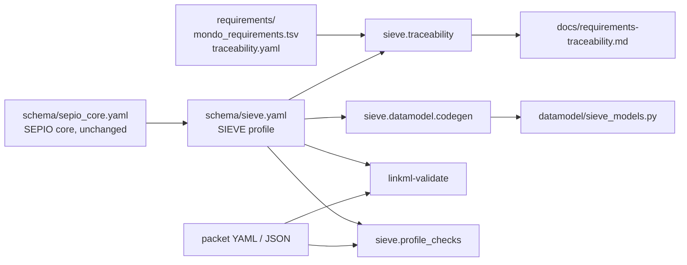

# Architecture

For the packet shape, start with the [Primer](primer.md); for every field, see the
[Data Model](data-model.md).

## The pieces

## Schema and model

### `schema/`

- **`sepio_core.yaml`**: a byte-identical copy of `sepio_classes.yaml` from
  sepio-linkml (commit `47f46b7`). `tests/test_profile_schema.py` compares it with the
  canonical file when sepio-linkml is checked out next to sieve, so it cannot drift or
  be edited by accident.
- **`sieve.yaml`**: the profile. It imports `linkml:types` and `sepio_core`, and every
  class specialises a core class. Narrowed core slots are declared in `slot_usage`.
  Predicate value sets are declared as `bindings`, and the claim-evidence matrix as a
  `permitted_evidence` annotation on each claim type.
- **`minimal.yaml`**: the separate minimal microschema (see
  [Minimal Evidence Model](monarch-evidence.md)). It is not imported by the profile.

### `datamodel/`

- **`sieve_models.py`**: Pydantic v2 classes generated from `schema/sieve.yaml`.
  Regenerate with `just gen-pydantic`; `tests/test_profile_schema.py` fails if the
  checked-in file is stale.
- **`codegen.py`**: wraps the LinkML Pydantic generator. The core's `Activity.date`
  slot shadows the `date` type in generated code on Python 3.10, so the generator
  output refers to the type through an alias instead of patching the core.
- **`__init__.py`**: re-exports the packet, claim-type, item, line, provenance and
  registry classes.

The `type` slot is a type designator throughout, so
`EvidencePacket.model_validate(data)` instantiates the concrete claim type and item
classes without a custom loader.

### `profile_checks.py`

`check_packet(packet)` runs the checks LinkML validation cannot express: predicate
bindings, the claim-evidence matrix, dangling item references, read coverage and
methods on AI and rule-based lines, resolution-chain contiguity, supersession, blind
approvals, and WARNING states. It works on the packet as a plain dict, and every
`Issue` names the requirement it enforces.

### `traceability.py` and `requirements/`

- `requirements/mondo_requirements.tsv`: the requirement rows, extracted from the
  Mondo requirements workbook by `scripts/extract_requirements.py`
  (`just extract-requirements`).
- `requirements/traceability.yaml`: per requirement, its SEPIO design module,
  disposition (`modelled`, `negative_constraint`, `not_desired`, `out_of_scope`),
  decisions and rationale.
- `sieve.traceability` joins those with the `annotations.requirements` on schema
  elements and renders `docs/requirements-traceability.md`
  (`scripts/render_traceability.py`, `just gen-traceability`).
- `tests/test_traceability.py` keeps the three consistent, including that the rendered
  page is current.

## Not yet rebuilt

The pre-profile application layer (Streamlit review app, DuckDB store, ingest / export,
Net Evidence Ratio scoring, CLI, ORCID login) and the minimal-to-SIEVE transform were
removed on 2026-11-20. A rebuild on the profile maps the old flow as follows: packet
`status` becomes `review_state` plus `assertion_decisions`, `CurationDecision` becomes
`AssertionDecision`, per-item ratings become `LineStatusChange`s, and the Net Evidence
Ratio becomes the inclusion score (`sieve.inclusion_score`).

## Design notes

- **Canonical core, unchanged.** The profile narrows the core and never redefines it,
  so a SIEVE packet is SEPIO data and core updates can be taken by replacing one file.
- **Traceability next to the model.** Requirement IDs sit on the schema elements that
  realise them, so the mapping cannot drift from the model; tests enforce both
  directions.
- **Two validation layers.** JSON Schema (via linkml-validate) for structure and class
  rules; `profile_checks` for anything that reads inside a Coding or across
  references.
- **One packet per claim, versioned.** Decisions name the packet version they were
  given on, so a change in evidence re-queues the claim instead of silently inheriting
  an old sign-off.
- **YAML packets**: human-readable, diff-friendly, and easy to keep under version
  control next to ontology work.
