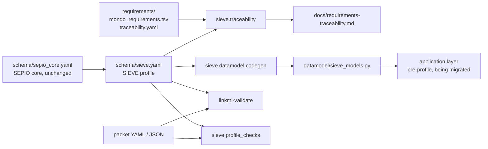
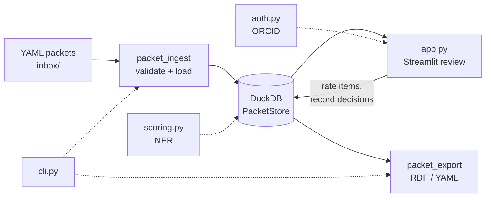

# Architecture

!!! warning "Application layer not yet migrated"
    The schema, the generated model, the profile checks and the traceability tooling
    below work with the current profile. The application layer (`app.py`,
    `scoring.py`, `store.py`, `datamodel/loaders.py`, `packet_ingest.py`,
    `packet_export.py`, `cli.py` and the LinkML-Map transforms) still targets the
    pre-profile model and is broken: it imports classes that no longer exist. It is
    being migrated (`issues/issue_migrate_app_to_profile.md`). Its description is kept
    here as a record of what it does.

For the packet shape, start with the [Primer](primer.md); for every field, see the
[Data Model](data-model.md).

## The pieces

## Schema and model (working)

### `schema/`

- **`sepio_core.yaml`**: a byte-identical copy of the SEPIO core from sepio-linkml
  (commit `8c2c233`). `tests/test_profile_schema.py` pins its hash, so it cannot be
  edited by accident.
- **`sieve.yaml`**: the profile. It imports `linkml:types` and `sepio_core`, and every
  class specialises a core class. Narrowed core slots are declared in `slot_usage`.
  Predicate value sets are declared as `bindings`, and the claim-evidence matrix as a
  `permitted_evidence` annotation on each claim type.
- **`minimal.yaml`**: the separate minimal microschema (see
  [Minimal Evidence Model](monarch-evidence.md)). It is not imported by the profile.

### `datamodel/`

- **`sieve_models.py`**: Pydantic v2 classes generated from `schema/sieve.yaml`.
  Regenerate with `just gen-pydantic`; `tests/test_profile_schema.py` fails if the
  checked-in file is stale.
- **`codegen.py`**: wraps the LinkML Pydantic generator. The core's `Activity.date`
  slot shadows the `date` type in generated code on Python 3.10, so the generator
  output refers to the type through an alias instead of patching the core.
- **`__init__.py`**: re-exports the packet, claim-type, item, line, provenance and
  registry classes.

The `type` slot is a type designator throughout, so
`EvidencePacket.model_validate(data)` instantiates the concrete claim type and item
classes without a custom loader.

### `profile_checks.py`

`check_packet(packet)` runs the checks LinkML validation cannot express: predicate
bindings, the claim-evidence matrix, dangling item references, read coverage and
methods on AI and rule-based lines, resolution-chain contiguity, supersession, blind
approvals, and WARNING states. It works on the packet as a plain dict, and every
`Issue` names the requirement it enforces.

### `traceability.py` and `requirements/`

- `requirements/mondo_requirements.tsv`: the requirement rows, extracted from the
  Mondo requirements workbook by `scripts/extract_requirements.py`
  (`just extract-requirements`).
- `requirements/traceability.yaml`: per requirement, its SEPIO design module,
  disposition (`modelled`, `negative_constraint`, `not_desired`, `out_of_scope`),
  decisions and rationale.
- `sieve.traceability` joins those with the `annotations.requirements` on schema
  elements and renders `docs/requirements-traceability.md`
  (`scripts/render_traceability.py`, `just gen-traceability`).
- `tests/test_traceability.py` keeps the three consistent, including that the rendered
  page is current.

## Application layer (pre-profile)

- **`datamodel/loaders.py`**: `load_packet(path)` / `packet_from_dict(data)` dispatched
  inlined evidence items to concrete classes by `type:` (`EVIDENCE_ITEM_TYPES`). The
  profile's type designators make this unnecessary; the module currently fails at
  import.
- **`packet_ingest.py`**: `validate_packet_dict(data)`, `ingest_packet_file(path,
  store)`, `ingest_packet_directory(path, store)`.
- **`store.py`**: `PacketStore`, a DuckDB store (default `data/sieve.duckdb`) holding
  each packet as JSON plus promoted columns (`evidence_packets`) and a decision log
  (`packet_decisions`). Methods: `insert_packet`, `get_packet`, `list_packets`,
  `get_stats`, `update_status`, `set_item_rating`, `record_decision`,
  `get_decisions`.
- **`scoring.py`**: `net_evidence_ratio(packet)`, (S+ - S-) / (S+ + S- + S0) over line
  weights. To be replaced by the inclusion score S computed from the claim type's
  `AggregationRule`.
- **`cli.py`**: Typer CLI with `run`, `ingest`, `validate`, `export` (see
  [CLI Reference](cli.md)).
- **`app.py`**: Streamlit app with Dashboard, Review Queue (per-item accept / reject,
  packet decisions), Ingest and Export views.
- **`auth.py`**: ORCID OAuth with a `curators.yaml` allow-list; `SIEVE_DEV_MODE=true`
  bypasses login. It does not depend on the data model.
- **`packet_export.py`**: `packet_to_yaml`, `export_packets_to_yaml`,
  `packet_to_rdf`, `export_packets_to_rdf`. RDF export wrote an `owl:Axiom` reifying
  the statement, linked to the packet by `SEPIO:0000124`, with `oboInOwl:source`
  annotations for accepted packets and `IAO:0000233` for rejected and controversial
  ones.
- **`transform/`**: LinkML-Map specs for DisMech → minimal → SIEVE. The second hop
  emits the pre-profile shape (see [Minimal Evidence Model](monarch-evidence.md)).

The migration maps the old flow onto the profile: packet `status` becomes
`review_state` plus `assertion_decisions`, `CurationDecision` becomes
`AssertionDecision`, per-item ratings become `LineStatusChange`s, and the Net Evidence
Ratio becomes the inclusion score.

## Design notes

- **Canonical core, unchanged.** The profile narrows the core and never redefines it,
  so a SIEVE packet is SEPIO data and core updates can be taken by replacing one file.
- **Traceability next to the model.** Requirement IDs sit on the schema elements that
  realise them, so the mapping cannot drift from the model; tests enforce both
  directions.
- **Two validation layers.** JSON Schema (via linkml-validate) for structure and class
  rules; `profile_checks` for anything that reads inside a Coding or across
  references.
- **One packet per claim, versioned.** Decisions name the packet version they were
  given on, so a change in evidence re-queues the claim instead of silently inheriting
  an old sign-off.
- **YAML packets**: human-readable, diff-friendly, and easy to keep under version
  control next to ontology work.
