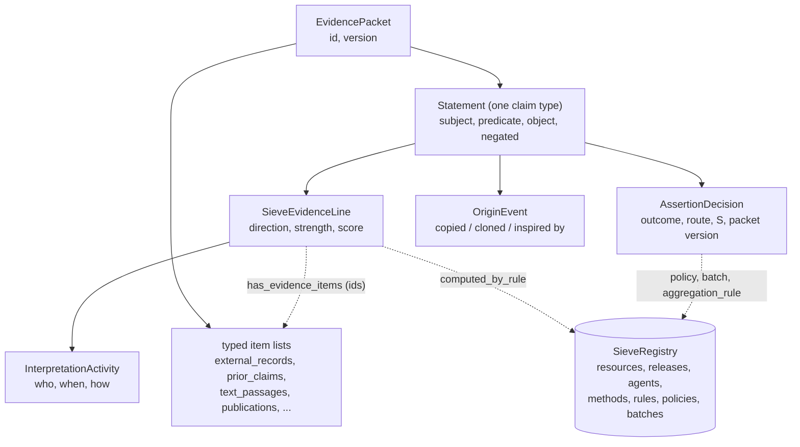

# Data Model

This is the reference for the SIEVE evidence model. For the concepts in plain
terms, read the [Primer](primer.md) first.

SIEVE is a **profile of the SEPIO core information model**, in two LinkML files:

- `schema/sepio_core.yaml`: the canonical SEPIO core, copied unchanged from
  [sepio-linkml](https://github.com/sepio-framework/sepio-linkml) (commit `8c2c233`)
  and pinned by hash in `tests/test_profile_schema.py`.
- `schema/sieve.yaml`: the profile (`id: https://w3id.org/sieve`). It imports the
  core, and every class in it specialises a core class. Inherited slots keep or narrow
  their core range. Nothing in the core is redefined.

Names follow the core's camelCase. The profile was built from the Mondo requirements
collection: each class, slot and enum value that realises a requirement carries the
requirement ID in `annotations.requirements`, and the decision-log IDs behind it in
`annotations.decisions`. The requirement-by-requirement mapping is on the
[Requirements Traceability](requirements-traceability.md) page, generated from those
annotations.

!!! note "Generated reference"
    Every class, slot and enum has a generated page under the
    [Schema Reference](elements/index.md). This page is the guided tour.

## The shape of the data

- **One `EvidencePacket` per claim.** A packet (is_a `DataSet`) holds one claim-type
  statement, the evidence items its lines refer to, and a required `version`. A
  change to its lines, items or score makes a new version (`previous_version` points
  back). Packets are never deleted: a rejected claim stays on record with its
  evidence and decisions.
- **Lines live on the statement, items live on the packet.** Evidence lines are
  inlined under `statement.has_evidence_lines`. Evidence items sit in typed lists on
  the packet (`external_records`, `prior_claims`, `text_passages`,
  `publications`, `web_pages`, `guidelines`, `computational_scores`), and lines refer
  to them by id.
- **Shared reference data is maintained in a `SieveRegistry`.** Information resources,
  source releases, agents, methods, aggregation rules, decision policies and batch
  sign-offs are maintained once there.
- **A packet is self-contained.** Its required `reference_snapshot` (a `SieveRegistry`) holds a
  frozen copy, as of the packet version, of every registry entry the packet references.
  Every reference must resolve inside the packet (`UNRESOLVED_REFERENCE` in
  `sieve.profile_checks`), so revising the registry never changes how an existing packet
  version reads (D-049, D-051, D-060).
- **Released artefacts** are `EvidencePacketCollection`s. Encoding provenance (which
  pipeline serialised the dump, with which export rules) is recorded there, never
  per claim.
- Every entity carries `id` and `type`. `type` is the type designator, so a loader or
  validator knows which claim type, item class or activity it is looking at.



## SEPIO design modules

The core names no modules, so the profile groups its classes into six, following the
core's class groups. Each requirement is assigned to one module in
`requirements/traceability.yaml`.

| Module | SEPIO core classes | Profile classes |
|---|---|---|
| `statement` | Statement, Proposition, Qualifier | `SieveStatement` and the ten claim types |
| `evidence-item` | InformationEntity, Document, DataItem, DataSet, StudyResult | `ExternalRecord`, `TextPassage`, `Publication`, `WebPage`, `GuidelineDocument`, `ComputationalScore`, `InformationResource`, `SourceRelease`, `EvidencePacket` |
| `evidence-line` | EvidenceLine | `SieveEvidenceLine`, `LineStatusChange` |
| `provenance` | Activity, Contribution, Agent, Method | `SieveAgent`, `SieveMethod`, `AggregationRule`, `DecisionPolicy`, `BatchSignOff`, `SieveContribution`, `InterpretationActivity`, `AssertionDecision`, `OriginEvent`, `ResolutionChain`, `AlignmentStep` |
| `record-metadata` | RecordMetadata | `RetrievalMetadata` |
| `utility` | Coding, Extension, Qualifier | `TextLocation`, `QualityRating`, `LevelAssignment`, `AppliedRule` |

### Statement

`SieveStatement` (abstract, is_a `Statement`) is a Mondo claim as an identified,
reified statement. Subject, predicate and object sit directly on the statement. There
are no `Proposition` objects: the core `proposition` slot is inherited but unused, and
concordance and dispute are matched on subject, predicate, object and `negated`.

| Field | Range | Req | Description |
|---|---|---|---|
| `subject` | uriorcurie | Yes | The Mondo term the claim is about. |
| `predicate` | Coding | Yes | The relation. Each claim type binds it to a value set. |
| `object` | string / uriorcurie | Yes | Term, text or value, depending on the claim type. |
| `negated` | boolean | No | The claim is that subject-predicate-object does **not** hold. Default false. |
| `statement_text` | string | No | Human-readable rendering of the claim. |
| `review_state` | ReviewState | Yes | `NOT_VERIFIED` (default), `PENDING_REVIEW`, `VERIFIED`. Workflow state, distinct from the decision outcome. |
| `proposing_channel` | ProposingChannel | No | Who proposed the claim (curator, source ingest, lexical pipeline, AI agent, ...). Selects the claim prior. |
| `has_evidence_lines` | SieveEvidenceLine[] | No | The evidence lines, inlined. |
| `has_evidence` | ids | No | Direct claim-to-item links with no interpretation. |
| `has_evidence_from_sources` | InformationResource ids | No | Source-level attribution without a record id (e.g. MONDO:DOID). |
| `origin` | OriginEvent[] | No | Where the claim was copied, cloned or adapted from. |
| `assertion_decisions` | AssertionDecision[] | No | Decision history, oldest first. |
| `contributions` | SieveContribution[] | No | Non-asserting roles: provider, stakeholder, endorser. |
| `score` | float, [-1, 1] | No | The current inclusion score S. |
| `strength` | string | No | The band of S, as declared by the rule that computed it. |
| `direction` | Direction | No | The sign of S. |

Each concrete subclass is one claim type. It binds `predicate` to its value set
(`bindings`) and lists the evidence-item classes it accepts in a `permitted_evidence`
annotation (the claim-evidence matrix).

| ID | Class | Predicates | Permitted evidence |
|---|---|---|---|
| C001 | `TermExistenceStatement` | `rdf:type`, `owl:deprecated`, `IAO:0100001`, `oboInOwl:consider` | ExternalRecord, prior claim, Publication, GuidelineDocument |
| C002 | `DefinitionStatement` | `IAO:0000115` | Publication, WebPage |
| C003 | `SynonymStatement` | `oboInOwl:has{Exact,Related,Narrow,Broad}Synonym` | ExternalRecord, prior claim, TextPassage, Publication, WebPage, ComputationalScore |
| C004 | `SubclassStatement` | `rdfs:subClassOf`, `owl:equivalentClass` | ExternalRecord, prior claim, TextPassage, Publication, WebPage, GuidelineDocument |
| C005 | `NegativeSubclassStatement` | as C004, with `negated: true` | ExternalRecord, prior claim, Publication |
| C006 | `MappingStatement` | `skos:exactMatch`, `broadMatch`, `narrowMatch`, `relatedMatch` | ExternalRecord, prior claim, ComputationalScore |
| C007 | `DiseaseAttributeStatement` | `RO:0004003`, `RO:0000053`, `RO:0004029`, `RO:0004026`, `RO:0014001`, `RO:0002162`, `mondoRel:predisposes_towards` | ExternalRecord, prior claim, TextPassage, Publication, WebPage, GuidelineDocument |
| C008 | `SubsetMembershipStatement` | `oboInOwl:inSubset` | ExternalRecord, prior claim |
| C009 | `MetaclassStatement` (candidate) | `sieve:isKindOfClass`; object is a `DiseaseKind` | ExternalRecord, prior claim |
| C010 | `ValueSetMembershipStatement` (candidate) | `sieve:memberOfRecordScope` | ExternalRecord, prior claim |

Some claim types add qualifiers: `obsolescence_reason` and `scheduled_obsoletion_date`
on C001; `preferred`, `valid_direction` and `object_obsolete_in_source_version` on C006.
C004 represents a logical definition as one statement per `intersection_of` element.
C009 and C010 use `sieve:` placeholder IRIs for their predicates.

### Evidence items

An evidence item is the information interpreted as evidence. Whether an item is
**evidence** (corroboration) or **origin** depends on where it is referenced: from an
evidence line, or from `statement.origin`.

| Class | Core parent | Packet list | What it is |
|---|---|---|---|
| `ExternalRecord` | InformationEntity | `external_records` | A record in an external database or terminology (`DOID:14250`, `OMIM:219700`), as read from a release. Requires `resource` and `record_metadata`; `obsolete_in_source` flags obsolete records. |
| any claim type (e.g. `SubclassStatement`) | Statement | `prior_claims` | A prior claim a source makes, in its own identifiers (`DOID:14250 is_a DOID:630`), typed by what it claims, never by its role. `reported_in` names the record; `groundings` records how each id was resolved to Mondo; `own_log_odds` is set when a competing-claim line cites it (D-069). |
| `TextPassage` | Statement | `text_passages` | A verbatim passage (`statement_text`) from a document (`reported_in`). Created in the Mondo ecosystem, so it requires its extraction `contributions` and a `quote_verification` outcome. |
| `Publication` | Document | `publications` | A PMID, DOI or ISBN. Publications sharing a `reports_study` key are not independent. |
| `WebPage` | Document | `web_pages` | A non-scholarly page (GARD, MedlinePlus, Wikipedia). GitHub issues are not web-page evidence: they go in a contribution's `context`. |
| `GuidelineDocument` | Document | `guidelines` | A guideline or consensus document. |
| `ComputationalScore` | DataItem | `computational_scores` | A computed score (lexical match, Boomer, AI score): `value`, the method in `specified_by`, `software_version`, `parameters`. |

Two mixins supply the shared slots. `EvidenceItem` marks everything a line can point at
(including lines themselves, for higher-order lines). `UpstreamItem` marks items made
outside Mondo and adds `resource`, `generation_context` (study type or curation basis;
`sieve:basis_unknown` when the source does not say) and `resource_role_override`.

The registry describes sources as a whole. An `InformationResource` has a
`default_role` (`PRIMARY` or `AGGREGATOR`), `derives_content_from` (dependence between
sources) and dated `quality_ratings`. A `SourceRelease` is one versioned snapshot of a
resource.

### Evidence lines

`SieveEvidenceLine` (is_a `EvidenceLine`) is one evidentiary judgement: these items
bear on the enclosing claim, in this direction, with this strength. Its target is always
the enclosing statement, so the core `target_proposition` is unused.

| Field | Range | Req | Description |
|---|---|---|---|
| `has_evidence_items` | ids | No | Items (or other lines) this line interprets. |
| `direction_of_evidence_provided` | Direction | Yes | `supports` or `disputes`. There is no neutral. |
| `strength_of_evidence_provided` | string | No | Categorical band, from the rule's `strength_bands`. |
| `score_of_evidence_provided` | float, [0, 1] | No | Strength on the shared 0-1 scale. Direction is not carried by the sign. |
| `contributions` | InterpretationActivity[] | Yes | The interpretation act. A collective act is one contribution with `participants`. |
| `computed_by_rule` | AggregationRule id | No | Required for rule-based lines (profile check). |
| `confidence`, `confidence_basis` | float [0, 1], ConfidenceBasis | No | Data quality. A confidence requires a basis (class rule). |
| `data_quality_flags` | DataQualityFlag[] | No | Failure flags that gate the line (`QUOTE_NOT_FOUND`, `SUSPECTED_HALLUCINATION`, ...). |
| `independence_cluster` | string | No | Cluster assigned by the rule. Only the strongest line per cluster counts. |
| `validity`, `status_changes`, `supersedes` | LineValidity, LineStatusChange[], ids | No | Invalidation and supersession history. |
| `date_attached`, `last_confirmed`, `last_confirmed_against` | date, date, SourceRelease id | No | When the evidence was attached and last confirmed against a release. |

Lines are **immutable**. A misreading is corrected by a new line that `supersedes` the
old one. The old line becomes `INVALIDATED`, stays on record and is excluded from the
score. A `LineStatusChange` records who invalidated, superseded or accepted a line, when
and why. That is also where a reviewer's verdict on an AI's line goes.

### Provenance

| Class | is_a | Role |
|---|---|---|
| `SieveAgent` | Agent | A person (ORCID), organisation or group, or software. Dated `roles` and `trust_levels`; `software_version` and `model_name` for software; `members` for panels. |
| `SieveMethod` | Method | A versioned method: guideline, workflow, prompt version, export rule set. |
| `AggregationRule` | SieveMethod | Per claim type: line strengths, `strength_bands`, `confidence_floor`. Computes S. |
| `DecisionPolicy` | SieveMethod | A human-approved procedure under which an automated system may accept claims: scope, `acceptance_threshold`, pinned rules. It can only accept. |
| `BatchSignOff` | Activity | A one-off curator approval of a filtered result set: re-runnable `filter_query`, frozen `result_set` of `packet@version`, `review_bands`. |
| `SieveContribution` | Contribution | An agent's act, with `role`, `participants`, and `agent_role_at_time` / `agent_trust_at_time` snapshotted as of the act; `context` (issue, PR, call), `run_id`, `perspective`. |
| `InterpretationActivity` | SieveContribution | The act behind a line: `date`, `method_type`, `read_coverage`, `access_status`, and the checks an AI act records (`identifier_verified`, `grounding_checked`, `sought_disputing_evidence`, `reasoning_trace`). |
| `AssertionDecision` | SieveContribution | The decision on the claim (see [below](#two-levels-of-judgement)). |
| `OriginEvent` | Activity | How the claim entered Mondo: `derivation_type` (`CLONED_FROM`, `COPIED_FROM`, `INSPIRED_BY`), `source_item`, `source_label`, `source_release`, pipeline and date. |
| `ResolutionChain` | Activity | How a source id or mention was resolved to the target id: ordered `steps` for one `entity_slot`, with `chain_confidence`. |
| `AlignmentStep` | Activity | One extraction, translation, grounding or normalisation step: `input_value`, `output_value`, `method`, `quality_category`, `confidence` + basis, mapping set and version, `review_status`. |

### Record metadata

`RetrievalMetadata` (is_a `RecordMetadata`) says where and when a concrete record was
read: `retrieved_from` (resource), `source_release` or `source_version`, `retrieval_date`
and the source's own label at the time (`source_label`). It is required on
`ExternalRecord`. `EvidencePacketCollection.record_metadata` carries artefact-level
encoding provenance.

### Utilities

The core `Coding` (`code`, `label`, `system`, `system_version`) types the predicate and
generation context. The profile adds `TextLocation` (section, character offsets),
`QualityRating` (dated level, optionally per claim type), `LevelAssignment` (dated role
or trust level, optionally per domain) and `AppliedRule` (a named alignment rule with its
certainty).

## Two levels of judgement

SIEVE keeps two judgements apart:

1. **Evidence line**: does this item bear on the claim, which way, how strongly? Made
   by an interpreter (curator, panel, pipeline, AI agent), recorded with its
   `InterpretationActivity`, immutable once made.
2. **`AssertionDecision`**: does the claim go into Mondo? Made over all lines, and
   recorded with what it was given on.

| Field | Description |
|---|---|
| `outcome` | `ACCEPTED`, `REJECTED`, `CONTROVERSIAL`, `DEFERRED`. |
| `route` | `INDIVIDUAL_SIGN_OFF`, `CONSENSUS_SIGN_OFF`, `DELEGATED_POLICY`, `PROVIDER_AUTHORITY`, `BATCH_SIGN_OFF`. |
| `inclusion_score`, `score_band`, `aggregation_rule` | S at decision time, its band, and the rule version that computed it. |
| `signed_packet_version` | The packet version decided on. A later version re-queues the claim. |
| `policy`, `threshold_passed` | For policy routes. |
| `batch`, `review_depth` | For batch sign-offs. A `NONE`-depth approval adds no evidence. |
| `evidence_line` | The expert line this decision contributed, if any. |
| `contributor`, `date`, `rationale`, `context` | Who decided, when, why, where. |

Every claim rests on a human decision, made per claim (sign-off, consensus, batch) or
per policy. Class rules enforce that automated routes (`DELEGATED_POLICY`,
`PROVIDER_AUTHORITY`) can only accept and must name their policy, and that a batch
decision names its batch and review depth. Decisions accumulate: claims are
re-evaluated when rules, policies or evidence change.

## Three axes: provenance, evidence, data quality

Three questions are recorded separately, so one cannot stand in for another:

- **Provenance**: where did this come from, and who did what? `OriginEvent`,
  `ResolutionChain`, contributions and retrieval metadata. "Cloned from OMIM" is
  origin, not evidence that the term is right.
- **Evidence**: does it support or dispute the claim, and how strongly? Line
  `direction_of_evidence_provided` and `score_of_evidence_provided` in [0, 1].
- **Data quality**: was the evidence read and linked correctly? SEPIO `confidence` on
  lines and alignment steps, with a required `confidence_basis` (`MEASURED`,
  `DETERMINISTIC`, `PRIOR`). Confidence gates or discounts a line. It never rewrites
  the line's strength.

## The inclusion score

`statement.score` is the **inclusion score S** in [-1, 1]: one number saying whether
the claim should be in Mondo. The claim type's `AggregationRule` computes it (decision
D-063):

```text
w_i = d_i * s_i * q_i * c_i     direction (+1/-1), strength, source prior, confidence
one line per independence cluster (the strongest)
L   = L0 + k * sum(w_i)          L0 = claim prior (claim type + proposing channel)
S   = tanh(L / 2)                = 2 * P(true) - 1
```

Lines whose confidence is below the rule's `confidence_floor` are excluded. Above it,
confidence discounts the line, so a misread contributes nothing rather than negative
evidence. `statement.strength` is the band of S and `statement.direction` its sign.
S is computed, not asserted: a signer's view goes in as an expert line, not as an edit
to S. The S that a decision was given on is copied to `AssertionDecision.inclusion_score`.

The scoring code has not been written for this model yet. The values in the example
packets are illustrative (see `issues/issue_migrate_app_to_profile.md`).

## Validation

Two layers check a packet.

**linkml-validate** checks ranges, enums, cardinality and the class rules:

```bash
uv run linkml-validate -s schema/sieve.yaml -C EvidencePacket packet.yaml
uv run linkml-validate -s schema/sieve.yaml -C SieveRegistry registry.yaml
```

!!! warning "Quote dates in YAML"
    linkml-validate parses unquoted YAML dates (`date: 2026-10-20`) into date objects,
    which the generated JSON Schema rejects. Quote them (`date: "2026-10-20"`) or
    validate a JSON copy. The test suite loads YAML with dates kept as strings.

**`sieve.profile_checks.check_packet`** covers what linkml-validate cannot: predicate
bindings, the claim-evidence matrix, dangling references, read coverage on
document-based lines, methods on AI and rule-based lines, chain contiguity,
supersession and blind approvals. It also reports WARNING states that need a person
(obsolete-to-obsolete mappings, definitions with no source, read coverage not
recorded). Every issue names the requirement it enforces. See the [Python API](api.md#sieveprofile_checks).

## A complete example

A mapping claim accepted in a batch sign-off, adapted from
`tests/data/profile/valid/c006_down_syndrome_icd10cm_batch.yaml`. The ids `sieve:rule/...`,
`sieve:batch/...`, `sieve:release/...` and `infores:...` resolve in the packet's own
`reference_snapshot`, a frozen copy of the entries in the registry
(`tests/data/profile/registry.yaml`). The snapshot is left out of the excerpt below.

```yaml
id: sieve:pkt/MONDO_0008608-exact-ICD10CM_Q90
type: EvidencePacket
version: "2026-10-25"
statement:
  id: sieve:st/MONDO_0008608-exact-ICD10CM_Q90
  type: MappingStatement
  subject: MONDO:0008608
  predicate: {code: skos:exactMatch}
  object: ICD10CM:Q90
  preferred: true
  valid_direction: BOTH
  review_state: VERIFIED
  proposing_channel: LEXICAL_PIPELINE
  score: 0.93
  strength: strong
  direction: supports
  has_evidence_lines:
    - id: sieve:el/q90-lexical
      type: SieveEvidenceLine
      has_evidence_items: [sieve:score/q90-lexical]
      direction_of_evidence_provided: supports
      strength_of_evidence_provided: weak
      score_of_evidence_provided: 0.3
      computed_by_rule: sieve:rule/mapping-v1.0
      contributions:
        - id: sieve:act/q90-lexical
          type: InterpretationActivity
          contributor: sieve:agent/concordance-pipeline
          date: "2026-10-24"
          method_type: RULE_BASED_STRENGTH
          specified_by: [sieve:method/mondo-mapping-guide]
    - id: sieve:el/q90-record
      type: SieveEvidenceLine
      has_evidence_items: [ICD10CM:Q90]
      direction_of_evidence_provided: supports
      strength_of_evidence_provided: strong
      score_of_evidence_provided: 0.8
      computed_by_rule: sieve:rule/mapping-v1.0
      contributions:
        - id: sieve:act/q90-record
          type: InterpretationActivity
          contributor: orcid:0000-0001-5208-3432
          date: "2026-10-25"
          method_type: EXPERT_JUDGEMENT
          specified_by: [sieve:method/mondo-mapping-guide]
          read_coverage: STRUCTURED_RECORD
  assertion_decisions:
    - id: sieve:dec/q90-batch
      type: AssertionDecision
      contributor: orcid:0000-0001-5208-3432
      date: "2026-10-25"
      outcome: ACCEPTED
      route: BATCH_SIGN_OFF
      batch: sieve:batch/mappings-2026-10-25
      review_depth: EYEBALLED
      inclusion_score: 0.93
      score_band: strong
      aggregation_rule: sieve:rule/mapping-v1.0
      signed_packet_version: "2026-10-25"
external_records:
  - id: ICD10CM:Q90
    type: ExternalRecord
    label: Down syndrome
    resource: infores:icd10cm
    record_metadata:
      retrieved_from: infores:icd10cm
      source_release: sieve:release/icd10cm-2026
      retrieval_date: "2026-10-01"
      source_label: Down syndrome
computational_scores:
  - id: sieve:score/q90-lexical
    type: ComputationalScore
    value: "0.97"
    specified_by: [sieve:method/lexmatch]
    software_version: oak-0.6
    parameters: "normalize=true"
```

The other examples in `tests/data/profile/valid/` cover a synonym accepted under a
policy (C003), a negative subclass claim with disputing evidence (C005) and a
gene-disease claim with an AI-extracted passage and a panel sign-off (C007). More
packets are in `inbox/examples/`.

## Coming from the pre-profile model

The earlier snake_case model (`sepio_classes.yaml`, `status`, `ConcordanceItem`, ...)
is gone. Roughly:

| Before | Now |
|---|---|
| `status`, `CurationDecision` | `statement.review_state` + `statement.assertion_decisions` |
| items inlined in lines | items in typed packet lists, referenced by id |
| `ConcordanceItem` | a prior claim, e.g. `SynonymStatement` (the claim) + `ExternalRecord` (the record) |
| `SieveDocument` with `quote` | `Publication` / `WebPage` / `GuidelineDocument`, plus `TextPassage` for the quote |
| `ComputationalResult` | `ComputationalScore` |
| `AgentContribution` | an expert line with its `InterpretationActivity`, or a `SieveContribution` |
| item `rating` | `LineStatusChange` on the line |
| `neutral` direction | removed: lines support or dispute |
| Net Evidence Ratio | inclusion score S |
