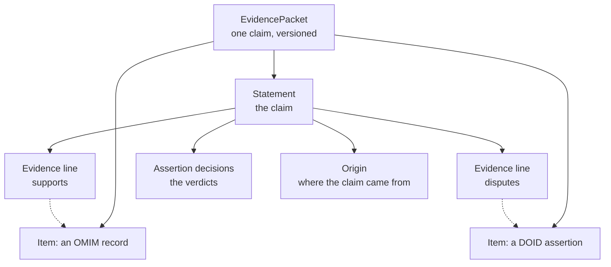

# SIEVE in Plain Terms

SIEVE records **why Mondo believes a claim**, and packages that "why" so a curator, or
a machine, can check it.

A *claim* is one statement about a Mondo term, for example:

> Down syndrome is **not** a subclass of hereditary disease

SIEVE puts that claim, the evidence for and against it, and the decisions taken on it
into one **evidence packet**:

```yaml
id: sieve:pkt/MONDO_0008608-excl-MONDO_0003847
type: EvidencePacket
version: "2026-10-20"
statement:
  id: sieve:st/MONDO_0008608-excl-MONDO_0003847
  type: NegativeSubclassStatement
  subject: MONDO:0008608              # Down syndrome
  predicate: {code: rdfs:subClassOf}
  object: MONDO:0003847               # hereditary disease
  negated: true                       # the claim is that it is NOT a subclass
  reviewState: VERIFIED
  hasEvidenceLines:
    - id: sieve:el/ds-doid-dispute
      type: SieveEvidenceLine
      hasEvidenceItems: [sieve:ca/doid-14250-isa-630]
      directionOfEvidenceProvided: disputes
      scoreOfEvidenceProvided: 0.5
      contributions:
        - id: sieve:act/ds-doid-concordance
          type: InterpretationActivity
          contributor: sieve:agent/concordance-pipeline
          date: "2026-10-20"
          methodType: COMPUTED_CONCORDANCE
          specifiedBy: [sieve:method/concordance-workflow]
  assertionDecisions:
    - id: sieve:dec/ds-excl-2026
      type: AssertionDecision
      contributor: orcid:0000-0001-5208-3432
      date: "2026-10-20"
      outcome: CONTROVERSIAL
      route: INDIVIDUAL_SIGN_OFF
      inclusionScore: 0.46
      signedPacketVersion: "2026-10-20"
concordantAssertions:
  - id: sieve:ca/doid-14250-isa-630
    type: ConcordantAssertion
    subject: DOID:14250               # Disease Ontology: Down syndrome
    predicate: {code: rdfs:subClassOf}
    object: DOID:630                  # genetic disease
    reportedIn: [DOID:14250]
    resource: infores:disease-ontology
```

Disease Ontology places Down syndrome under its genetic disease class, which grounds to
Mondo's hereditary disease, so its assertion enters as a **disputing** line. A curator
looked at it and kept the claim, marked controversial. The rest of this page
explains the parts.

---

## The shape of a packet



- **Statement**: the one claim. Its `type` says which kind of claim it is.
- **Evidence item**: one piece of information (a database record, another source's
  assertion, a passage from a paper, a computed score). Items sit in typed lists on
  the packet (`externalRecords`, `concordantAssertions`, `textPassages`, ...).
- **Evidence line**: one judgement that some items bear on the claim, in one
  direction, with some strength. Lines point at items by id.
- **Assertion decision**: whether the claim goes into Mondo, who decided, and on which
  packet version.
- **Origin**: where the claim was copied or cloned from. That is not the same as
  evidence for it.

Rules, policies, agents and information resources are shared, so they are maintained
once in a **registry**. Each packet still stands on its own: it carries a frozen
`referenceSnapshot` of every registry entry it refers to, as of its version.

---

## Ten kinds of claim

Each kind of Mondo claim is its own statement class, with its own allowed predicates
and its own allowed kinds of evidence:

| ID | Claim type | Example |
|---|---|---|
| C001 | `TermExistenceStatement` | the term exists, is obsolete, is replaced by another |
| C002 | `DefinitionStatement` | the term has this definition |
| C003 | `SynonymStatement` | "SPOAN syndrome" is an exact synonym |
| C004 | `SubclassStatement` | asthma is a respiratory system disorder |
| C005 | `NegativeSubclassStatement` | Down syndrome is not a hereditary disease |
| C006 | `MappingStatement` | MONDO:0008608 `skos:exactMatch` ICD10CM:Q90 |
| C007 | `DiseaseAttributeStatement` | cystic fibrosis has material basis in CFTR |
| C008 | `SubsetMembershipStatement` | the term is in the GARD rare subset |
| C009 | `MetaclassStatement` | the term is a grouping class (candidate) |
| C010 | `ValueSetMembershipStatement` | the term is an included title of an OMIM record (candidate) |

A synonym claim cannot use `skos:exactMatch` as its predicate, and a definition cannot
cite a computed score as evidence. These rules are checked.

---

## Two levels of judgement

SIEVE keeps two questions apart:

1. **Does this evidence bear on the claim?** That is an **evidence line**: direction
   (`supports` or `disputes`), strength on a 0-1 scale, and who interpreted it and how
   (curator, panel, pipeline or AI agent). Lines are never edited. A wrong line is
   invalidated and replaced, and both stay on record.
2. **Does the claim go into Mondo?** That is an **assertion decision**: outcome
   (`ACCEPTED`, `REJECTED`, `CONTROVERSIAL`, `DEFERRED`), the route (individual
   sign-off, consensus, batch sign-off, or an automated policy that a human approved),
   and the packet version and score it was given on.

Automated routes can only accept. Anything else goes to a person.

---

## Three things that are easy to confuse

| Axis | Question | Where it lives |
|---|---|---|
| **Provenance** | Where did this come from, and who did what? | `origin`, contributions, resolution chains, retrieval metadata |
| **Evidence** | Does it support or dispute the claim, and how strongly? | line direction and strength |
| **Data quality** | Was the evidence read and linked correctly? | line and step `confidence`, with its basis |

"This synonym was copied from OMIM in 2019" is provenance. "OMIM still lists it in the
2026 release" is evidence. "The OMIM id was matched to the Mondo term with certainty
1.0" is data quality. A low confidence reduces what a line counts for. It never changes
the line's strength.

---

## From evidence to a score

The **inclusion score S** is one number between -1 and +1 saying whether the claim
should be in Mondo. Each claim type has a versioned aggregation rule that computes it:

- each line counts its strength, signed by direction, weighted by the quality of the
  source and by the confidence it was read correctly;
- lines that echo the same upstream source form one cluster, and only the strongest
  line in a cluster counts;
- the sum is added to a prior for the claim type and proposing channel, and squashed
  into [-1, 1].

In the published worked examples, cystic fibrosis to CFTR (OMIM, an AI-extracted paper
passage and a ClinGen panel) comes out at S ≈ 0.97, and the Down syndrome claim above,
with DOID disputing and a curator supporting, at S ≈ 0.46. The score drives the review
queue. A person signs it off, and the decision records the S it was given on.

The scoring code for this model is still being written, so the scores in the example
packets are illustrative.

---

## Checking a packet

```bash
uv run linkml-validate -s schema/sieve.yaml -C EvidencePacket my_packet.yaml
```

then the profile checks in Python (`sieve.profile_checks.check_packet`). The
[Workflows](workflows.md) page has the details. The review app, ingest and RDF export
are being moved to this model and do not work with it yet.

---

## Where this comes from

SIEVE is a profile of the [SEPIO](https://github.com/sepio-framework/sepio-linkml) core
information model (Scientific Evidence and Provenance Information Ontology). The core is
imported unchanged, and every SIEVE class specialises a core class, so a SIEVE packet is
SEPIO data. The profile was built from Mondo's requirements collection; the
[Requirements Traceability](requirements-traceability.md) page shows which part of the
model answers which requirement.

For every field, see the [Data Model](data-model.md).
